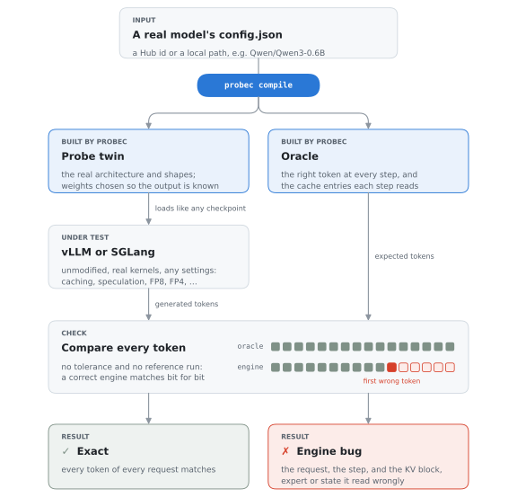
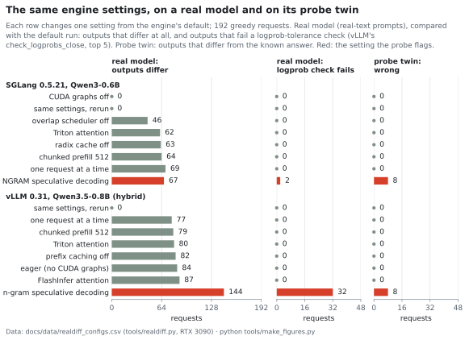

# probec

Known-answer checkpoints for testing LLM inference engines.

probec builds *probe twins*: checkpoints with a real model's architecture whose outputs are known in
advance. An inference engine runs a twin like any other model, so every token it generates is either
exactly right or a bug in the engine.

<picture>
  <source media="(prefers-color-scheme: dark)" srcset="docs/figures/overview-dark.svg">
  
</picture>

<picture>
  <source media="(prefers-color-scheme: dark)" srcset="docs/figures/realdiff-dark.svg">
  
</picture>

Why not test with the real model? Switching between two correct engine settings changes a quarter to almost
half of a real model's outputs, so a bug has to be told apart from noise with a tolerance and a trusted
reference run. On the twin, every correct setting is exact and only the settings with a bug deviate
([report §1](docs/REPORT.md#1-testing-an-engine-with-a-real-model)).

## Getting started

Linux, Python ≥ 3.10. Steps 1–2 run on a CPU; step 3 needs a GPU with vLLM or SGLang.

```bash
git clone https://github.com/DiaaAj/probec && cd probec
pip install -e ".[dev]"
```

**1. Build a twin of a real model** from its `config.json` (a Hub id or a local path):

```bash
probec compile --like Qwen/Qwen3-0.6B --layers 4 -o probes/qwen3-0.6b
```

**2. Check the twin on CPU** with HF transformers as the reference implementation (under a minute on a
laptop CPU). `certify` checks the static exactness conditions; `check` generates, compares every token
and layer state with the oracle, and injects KV-cache faults to show they are detected:

```bash
probec certify probes/qwen3-0.6b
probec check probes/qwen3-0.6b --quick
```
```text
(abridged)
{'attn': 'sdpa', 'dtype': 'torch.bfloat16', 'batch': 2, 'lengths': [130, 200], 'sample': False, 'tokens': 24, 'mismatches': 0, 'sec': 1.7}
{'len': 130, 'layer_states_checked': 36, 'non_bitwise': 0, 'logits_ok': True}
{"block_dup": {"trials": 2, "detected": 2, "localized": 2, ...}, "cross_request": {...}, "zero_block": {...}, ...}
probec check: 144 tokens, 0 mismatches; bitwise 36/36 layer states; OK
```

**3. Run it through an engine** across a matrix of serving configurations (one process per entry):

```bash
pip install -e ".[vllm]"                 # or ".[sglang]"
probec run probes/qwen3-0.6b --engine vllm --matrix quick
probec report out/results.jsonl
```
A run with a bug looks like this (vLLM 0.31.0 on a Qwen3.5-0.8B twin, abridged; the last rows are
vLLM #40875, fixed in 0.32.0):

| engine | program | config | generated tokens | mismatched | notes |
|---|---|---|---|---|---|
| vllm | hybrid | FLASH_ATTN/default | 49152 | 0 | |
| vllm | hybrid | FLASH_ATTN/no_prefix_cache | 49152 | 0 | |
| vllm | hybrid | FLASH_ATTN/preempt | 49152 | 0 | |
| vllm | hybrid | FLASHINFER/fp8kv | 49152 | 0 | |
| vllm | hybrid | FLASH_ATTN/ngram_spec_decoys | 49152 | 967 | 8 requests; first bad step 67 (prompt 3606 tok) |
| vllm | hybrid | FLASH_ATTN/ngram_spec_decoys_no_prefix_cache | 49152 | 2009 | 20 requests; first bad step 63 (prompt 4440 tok) |

Each record in `out/results.jsonl` also lists the failing requests with their first wrong step and the
prompt positions that step reads.

Twins of other architectures: `--program moe` (Qwen3-MoE), `--program mla` (DeepSeek V2/V3),
`--program posrecall` (RoPE at the real `rope_theta`); hybrid models (Qwen3.5, Qwen3-Next) select
`hybrid` automatically. Quantized checkpoints: `probec quantize <twin> --format fp8|fp8-block|int4-awq|int4-gptq|nvfp4`.
In CI, `probec run ... --strict` exits with status 2 on the first wrong token.

<details>
<summary>Matrices (<code>--matrix</code>)</summary>

`probec run --list` shows a matrix's entries. Every entry runs in its own process, and an entry that
crashes or exceeds `--entry-timeout` (default 1800 s) leaves an error record.

| Matrix | Entries |
|---|---|
| `quick` | default settings, two attention backends |
| `medium`, `default` | backends × {prefix caching + CUDA graphs, chunked prefill 512 with T = 1 sampling, eager + preemption}, FP8 KV cache, n-gram speculative decoding with and without decoy prompts; on vLLM, KV-fault injection through the real paged cache (`default` uses all backends, `medium` two) |
| `full` | `default` plus FLEX_ATTENTION / torch_native |
| `hopper`, `blackwell` | FA3, FlashMLA, CUTLASS-MLA, FlashInfer-MLA and FP8 paths |
| `ep2` | tensor and expert parallelism on two GPUs |
| `quant` | online FP8 quantization of a bf16 twin |
| `replay` | version-neutral settings, for testing old releases |
| hybrid twins | `quick`, `default`: prefix caching, shared prefixes, chunked prefill, preemption, state dtype, decode kernels, speculative decoding |

</details>

## What it checks

| Program | Architectures | What a wrong token means |
|---|---|---|
| `recall` | Llama, Mistral, Qwen2, Qwen3 (GQA, QK-norm, sliding window) | a KV read from the wrong block, slot, layer or request; a stale or never-written block; prefix-cache, chunked-prefill, preemption or speculative-decoding bookkeeping errors; softmax-scale faults (scale check) |
| `posrecall` | the same, at the model's real `rope_theta` and RoPE scaling | position-id slips, RoPE frequency or pairing errors, keys cached at the wrong position |
| `moe` | Qwen3-MoE | a token routed to the wrong expert, a dropped or duplicated expert, wrong top-k weights; the output names the expert |
| `mla` | DeepSeek V2/V3 (MLA), V3.2 (DSA sparse attention) | latent-cache misreads, MLA prefill/decode path errors, sparse top-k sets that lose the token being read |
| `hybrid` | Qwen3.5 (dense, MoE), Qwen3-Next: Gated DeltaNet + gated attention | lost, stale, zeroed, cross-request or wrong-layer recurrent states; lost decode-time updates; rejected drafts left in the state; plus `recall`'s KV errors |

Quantized twins (`probec quantize`): FP8 (per tensor, 128×128 blocks), INT4 AWQ and GPTQ, NVFP4. Their
weights are exactly representable in the format, so the quantized checkpoint has the same known answer.

## Bugs found

| | Engine, version | What goes wrong | Status |
|---|---|---|---|
| 1 | SGLang 0.5.20–0.5.22 | NGRAM speculative decoding with the radix cache and overlap scheduler overwrites cached KV of shared prefixes; requests reusing the prefix inherit it (8/192) | [sglang#44997](https://github.com/sgl-project/sglang/issues/44997) |
| 2 | vLLM 0.24.0–0.27.1 | MLA with prefix caching: wrong from the first token (6–7/96) | fixed in 0.28.0 by #50613; not reported before |
| 3 | vLLM 0.21.0–0.25.1 | MLA prefill merge reads the suffix output with the prefix head stride (9/33) | #42642, fixed in 0.26.0 |
| 4 | vLLM 0.28.0, B200 | MLA prefill returns base-2 log-sum-exp, merged as natural log after a prefix hit (59–62/64) | #52796, fixed in 0.29.0 |
| 5 | SGLang 0.5.14–0.5.22 | NVFP4 Marlin fallback below Blackwell: block-scale conversion underflows; every request garbled | [sglang#44998](https://github.com/sgl-project/sglang/issues/44998); fix proposed in sglang#45031 |
| 6 | vLLM 0.19.0–0.23.0 | FP8 Marlin skips the weight transpose of square layers (192/192) | #44735, fixed in 0.24.0 |
| 7 | vLLM ≤ 0.18.1 | NVFP4 Marlin scale underflow (the same as 5) | #34577, fixed in 0.19.0 |
| 8 | SGLang 0.5.14–0.5.22 | Marlin MoE (AWQ) on Ampere returns wrong expert outputs at random, even one request at a time | [sglang#44999](https://github.com/sgl-project/sglang/issues/44999) |
| 9 | SGLang 0.5.18–0.5.22 | block-FP8 (FP8 Marlin) on Ampere: a few wrong requests in some runs with the overlap scheduler | [sglang#45000](https://github.com/sgl-project/sglang/issues/45000) |
| 10 | vLLM 0.27.1–0.31.0 | n-gram speculative decoding on hybrid (Gated DeltaNet) models loses an accepted token's state update when a draft is partly accepted (8/192) | known as #40875 (reported as tool-call corruption), fixed in 0.32.0 by #56531; our report [vllm#62304](https://github.com/vllm-project/vllm/issues/62304) is a duplicate |

Bugs 1, 2, 5, 8 and 9 were not reported before. 3, 4, 6 and 7 are known bugs, replayed to check that
probec catches them; 10 was found as new and turned out to be a known bug whose fix shipped in vLLM 0.32.0.
Version ranges come from the release sweep ([report §3.3](docs/REPORT.md#33-release-history)); for 6, 0.19.0 comes
from the pull request that introduced the bug (#38092), since the sweep tested the last patch of each minor release.

## What the bugs cost

<picture>
  <source media="(prefers-color-scheme: dark)" srcset="docs/figures/bug_timeline-dark.svg">
  
</picture>

<picture>
  <source media="(prefers-color-scheme: dark)" srcset="docs/figures/bug_costs-dark.svg">
  
</picture>

- **They stay in releases for months.** The fixed bugs shipped for 14–88 days. For MLA models with prefix
  caching, every vLLM release from 0.21.0 to 0.27.1 (103 days) had one of three bugs, and the hybrid n-gram bug
  took 193 days from its first public report to a release with the fix.
- **They are silent.** Users saw tool calls corrupted in about half of requests (vLLM #40875) and FP8 models
  returning garbage with no error (#44110). Five of the ten bugs were never reported by users; probec found them.
- **Avoiding them costs money.** Turning the feature off until a fix ships costs one 8-GPU node about
  $10k–17k a month for prefix caching on MLA models, up to $11k for BF16 instead of FP8 weights on A100s, or
  1.5–2.3× slower decoding without n-gram speculation. For a deployment of DeepSeek's published size, turning
  off prefix caching would cost about $47,000 a day.
- **Catching them is cheap.** probec's release suite costs about $0.10 per release on one RTX 3090 and flags
  each of these bugs in the first release that has it.

Method, inputs and sources: [report §4](docs/REPORT.md#4-what-the-bugs-cost).

## Technical report

[`docs/REPORT.md`](docs/REPORT.md) has the evidence behind this page:

1. **Testing with a real model**: why correct settings disagree, and what a logprob-tolerance check can and
   cannot tell.
2. **How a probe twin works**: exactness by construction, and how a wrong token points to the block it read.
3. **Evaluation**: 617 engine configurations and 25.0M tokens with every wrong token explained; faults
   injected into vLLM's KV cache (all 120 that were read were detected, at the predicted step); one suite on
   22 releases of vLLM and SGLang.
4. **What the bugs cost**: the method and assumptions behind the estimate above.
5. **Limits**: what a probe twin does not catch.

Further documentation: [design](docs/DESIGN.md), [quantized weights](docs/QUANTIZED.md),
[hybrid models](docs/HYBRID.md), [full results per bug](docs/RESULTS.md), [tools](tools/README.md).

## Credits
The idea of compiling programs into transformer weights comes from Tracr (Lindner et al., 2023,
DeepMind). probec does not use Tracr or RASP; it hand-builds exactness-constrained weights for
production architectures.

## License
Apache-2.0.
