# probec: technical report

How probe twins work, how probec was validated on vLLM and SGLang, and what the bugs it found cost. Every
figure is regenerated from the data in [`data/`](data) by `python tools/make_figures.py`.

**Contents:** [1. Testing an engine with a real model](#1-testing-an-engine-with-a-real-model) ·
[2. How a probe twin works](#2-how-a-probe-twin-works) · [3. Evaluation](#3-evaluation) ·
[4. What the bugs cost](#4-what-the-bugs-cost) · [5. Limits](#5-limits) ·
[6. Reproducing this report](#6-reproducing-this-report)

## 1. Testing an engine with a real model
The usual way to test an engine is to compare its outputs with another run: HF transformers, another
backend, an earlier release. We ran real models and their probe twins through the same nine settings
of each engine (192 requests, greedy, up to 256 tokens; real-text prompts for the real models: shipment
logs shared by eight requests each, with tasks that copy from them).

<picture>
  <source media="(prefers-color-scheme: dark)" srcset="figures/realdiff_pairs-dark.svg">
  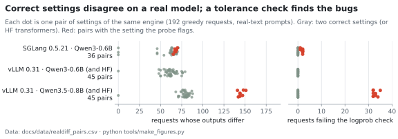
</picture>

- **Outputs differ for reasons that are not bugs.** Changing one correct setting (attention backend,
  prefix caching, chunked prefill, CUDA graphs, batch size) changes 24–45% of the real model's
  outputs (one exception: SGLang without CUDA graphs is identical). Rerunning the same settings changes
  none. Floating-point sums depend on kernels and batch shapes, and greedy decoding turns one changed
  token into a different continuation.
- **A logprob-tolerance check removes that noise.** vLLM's `check_logprobs_close` accepts a difference
  when, at the first differing token, each run's token is among the other's top 5. It passes every pair
  of correct settings here, and it flags both settings with bugs: 32 of 192 requests for vLLM's
  hybrid n-gram bug, 2 of 192 for SGLang's NGRAM bug. It needs a trusted reference run and a
  tolerance, and a failure says that something changed, not what.
- **The probe twin needs neither.** Every correct setting reproduces the known answer exactly; the two
  settings with bugs get 8 of 192 requests wrong, and each failing request comes with its first wrong
  step and the cached block or state it read.

What vLLM #40875 does to real text: in a copy task, the run with n-gram speculation drops a word the
default run was certain of (`awaiting pickup` at log-probability −0.0), in an otherwise fluent table:

```diff
- | 2025-01-05 | 42266 | 118 | carbon brushes | North depot | awaiting pickup |
+ | 2025-01-05 | 42266 | 118 | carbon brushes | North depot | awaiting |
```

## 2. How a probe twin works

### 2.1 Exact by construction
Floating-point inference is not exact in general, so the twin's weights are designed so that the answer
does not depend on the small errors every kernel makes:

| Operation | Why it is normally inexact | Construction |
|---|---|---|
| matrix multiplies | sums are rounded | every weight is ±1, 16 or a power of two; each output sums at most two terms |
| RMSNorm | divides by a square root | every hidden vector has energy exactly 64 · hidden, so the norm divides by exactly 8 |
| attention softmax | `exp()` | the right key wins by ≥ 30–50 nats: every other weight is ≤ e⁻³⁰ |
| SiLU gates | `sigmoid()` | saturated: silu(32) = 32 in fp32 |
| RoPE | sin/cos | content codes sit in RoPE pairs that barely rotate, or in MLA's no-RoPE part |
| sampling | randomness | the right token wins by ≥ 32 nats, so greedy and T = 1 agree |

What survives (about 10⁻²¹ after attention, 10⁻¹³ after a saturated gate) is far below half a bf16 ulp,
so storing a result in bf16 rounds it back to the designed value. `probec certify` checks these
conditions statically; `probec check` checks on CPU that every layer's state is bit-identical to the
design. Full constructions: [`DESIGN.md`](DESIGN.md).

### 2.2 The recall program
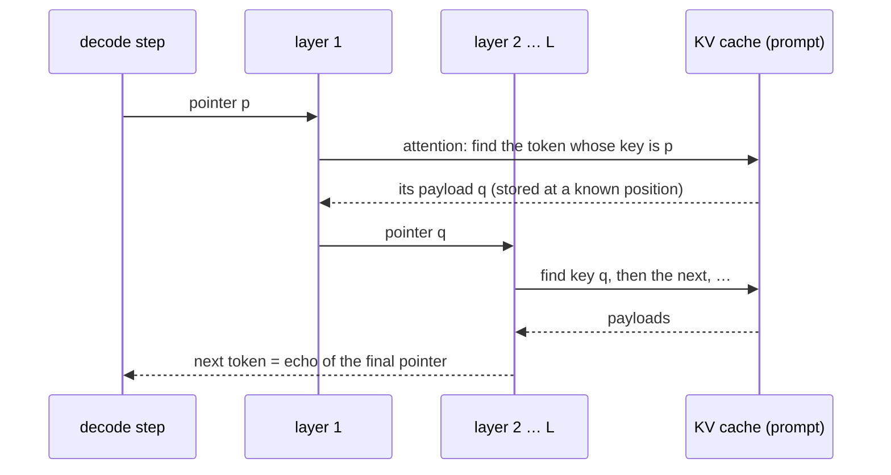

### 2.3 From a wrong token to the faulty block
The oracle knows which prompt positions every decode step reads, in every layer. A fault therefore
shows up at a predictable step, and the first wrong token points at the data that was read.

<picture>
  <source media="(prefers-color-scheme: dark)" srcset="figures/readmap-dark.svg">
  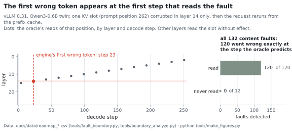
</picture>

### 2.4 How a twin differs from the real model
- Weights are synthetic (bf16); quantization configs are dropped (re-added by `probec quantize`).
- `tie_word_embeddings` is false; `recall` pins `rope_theta` to 1e12 (`posrecall` keeps the real value);
  MLA twins use dense MLPs in every layer and drop MTP layers.
- Twins of multimodal checkpoints (Qwen3.5) are the text model; vision towers and MTP heads are dropped.
  MoE hybrids keep the experts' shapes, with the routed experts at zero.
- Everything else (architecture class, widths, head counts, vocabulary, norms, RoPE scaling) is the real
  model's, so the engine selects the same kernels.

## 3. Evaluation

### 3.1 Correct engine paths stay exact
Every matrix entry run so far, on every engine release, GPU and checkpoint format: 617 entries and 25.0M
generated tokens checked against the oracle. The 116 entries with wrong tokens are all explained: 93 by the
engine bugs in the [README](../README.md#bugs-found) and 23 by probe bugs found and fixed during validation
(oracle mistakes in three program versions, each rerun on the same kernels after the fix). Full tables:
[`RESULTS.md`](RESULTS.md).

<picture>
  <source media="(prefers-color-scheme: dark)" srcset="figures/coverage-dark.svg">
  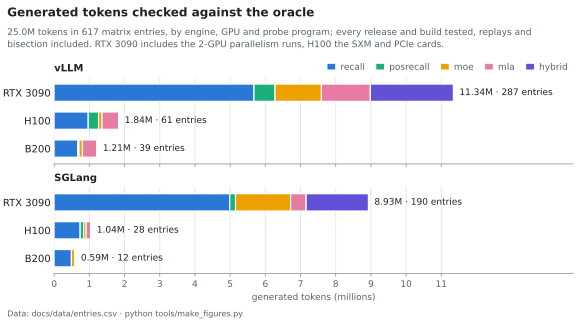
</picture>

<picture>
  <source media="(prefers-color-scheme: dark)" srcset="figures/outcomes-dark.svg">
  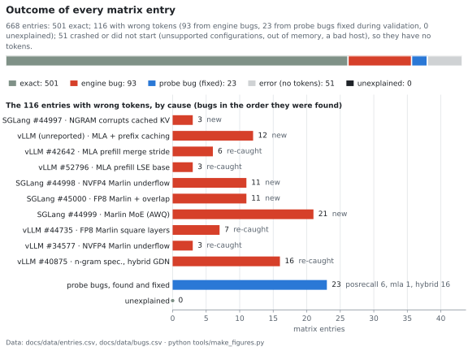
</picture>

### 3.2 What it detects
Faults injected into vLLM 0.31's real paged KV cache through the self-describing cache (each block's
keys name the tokens it holds), one block of one cached request at a time, then the request reruns.
Every content fault that the generation reads is detected, at exactly the step the oracle predicts
(120 of 120; the 12 it never reads cannot change the output). Magnitude-only errors are absorbed up to
large sizes: the probe checks where data comes from, not its precision. The scale check flags
softmax-scale errors outside 0.77–1.30 on every request.

<picture>
  <source media="(prefers-color-scheme: dark)" srcset="figures/boundary-dark.svg">
  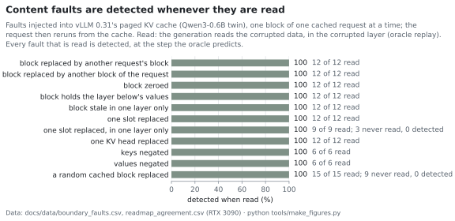
</picture>

<picture>
  <source media="(prefers-color-scheme: dark)" srcset="figures/boundary_numeric-dark.svg">
  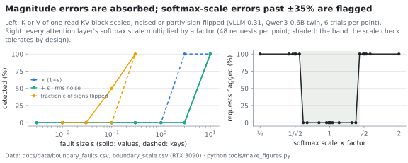
</picture>

### 3.3 Release history
One fixed suite (dense, MLA, MoE, FP8, NVFP4, AWQ and hybrid twins; version-neutral settings) on every
vLLM release from 0.18.1 to 0.32.0 and SGLang releases from 0.5.14 to 0.5.22. Every bug in its range
shows up as a band of releases. Two observations the bug reports did not have: SGLang's NGRAM bug arrived
in 0.5.20 (0.5.19 is exact), and vLLM 0.32.0 is exact on the hybrid n-gram workload that failed on every
earlier release able to load the twin. Runs end by length, which hides the NGRAM bug from 0.5.22 on;
SGLang's FP8-block failures are intermittent, so a clean cell there is not proof of a fix.

<picture>
  <source media="(prefers-color-scheme: dark)" srcset="figures/sweep-dark.svg">
  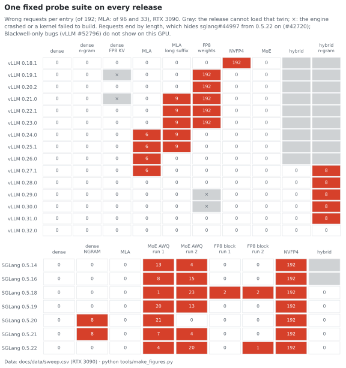
</picture>

### 3.4 Bugs, isolated
Because correct settings are exact, one setting can be changed at a time and every change in the count
means something. Two of the bugs:

<picture>
  <source media="(prefers-color-scheme: dark)" srcset="figures/hybrid_isolation-dark.svg">
  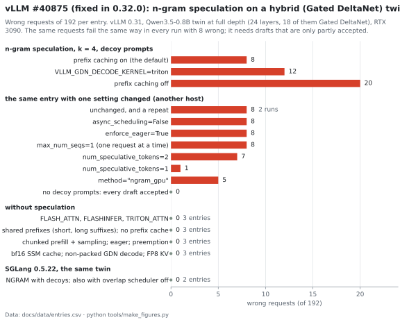
</picture>

<picture>
  <source media="(prefers-color-scheme: dark)" srcset="figures/sglang_ngram-dark.svg">
  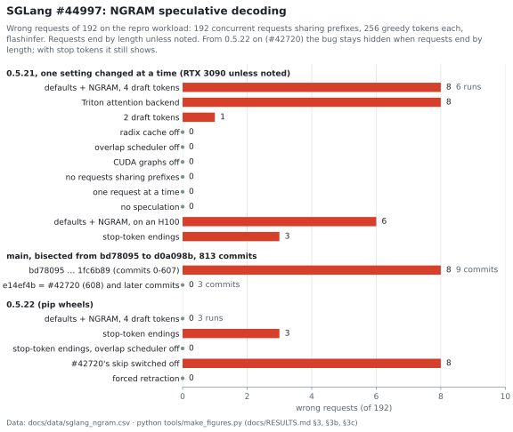
</picture>

The failures are deterministic down to the token. A vLLM contributor reran the hybrid n-gram entries on an
AMD MI308X with ROCm ([vllm#62304](https://github.com/vllm-project/vllm/issues/62304)) and got the same 967
wrong tokens in the same 8 requests on 0.31.0, and none on 0.32.0.

### 3.5 Running time
A matrix entry (one engine start, 192 requests × 256 tokens) takes about a minute on one GPU, most of it
engine start-up. The release suite of §3.3 takes 12 minutes per vLLM release and 19 per SGLang release on one
RTX 3090; all 22 releases took 5.3 GPU-hours.

<picture>
  <source media="(prefers-color-scheme: dark)" srcset="figures/runtime-dark.svg">
  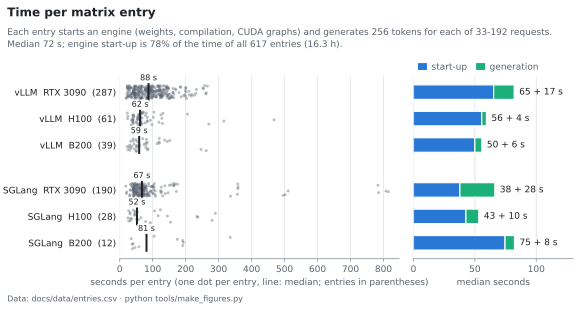
</picture>

## 4. What the bugs cost

A back-of-envelope estimate in three parts: how long each bug stayed in releases, what a deployment pays to
avoid it until a fix ships, and what checking for it costs. Inputs and results: [`data/bugs.csv`](data/bugs.csv),
`release_dates.csv` (PyPI), `cost_assumptions.csv`, `cost_constants.csv` and `bug_costs.csv`, from
`python tools/bug_costs.py`.

### 4.1 How long the bugs shipped
<picture>
  <source media="(prefers-color-scheme: dark)" srcset="figures/bug_timeline-dark.svg">
  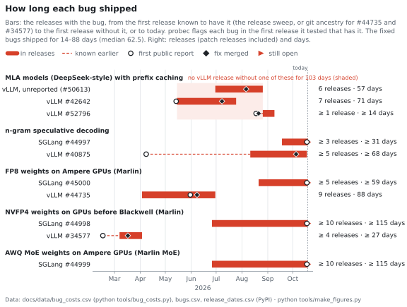
</picture>

- The fixed bugs shipped for 14–88 days (median 62.5). The four SGLang bugs are still open, after 31 to more than
  115 days in releases.
- For MLA models with prefix caching (DeepSeek, Kimi, GLM), no vLLM release from 0.21.0 to 0.27.1 was free of
  one of three bugs: 103 days and 10 releases.
- The reported bugs took 22–193 days from their first public report to a release with the fix: vLLM #40875
  193 days (first reported as [#39273](https://github.com/vllm-project/vllm/issues/39273) on April 8), #42642
  72, #34577 47, #44735 30 and #52796 22.
- Before anyone reported them, bugs sat in releases unnoticed: #44735 for 58 days; the MLA prefix-caching bug
  for 57 days, after which a scheduling change (#50613) fixed it without a report; the SGLang bugs for 30 to more
  than 114 days, until probec's reports.

### 4.2 What working around a bug costs
<picture>
  <source media="(prefers-color-scheme: dark)" srcset="figures/bug_costs-dark.svg">
  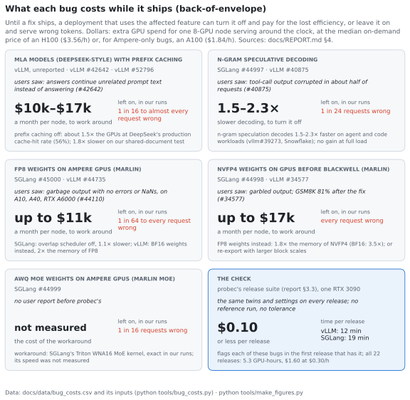
</picture>

Until a fix ships, an operator who knows about a bug can turn the affected feature off. The estimate prices that
for one 8-GPU node serving around the clock. A node-month is 8 × 730 GPU-hours: $20.8k with H100s at $3.56 per
hour, $10.7k with A100s at $1.84, the median on-demand prices across 39 and 40 providers on 2026-10-19
([GetDeploying](https://getdeploying.com/reference/cloud-gpu/nvidia-h100)).

| Workaround | Bugs | Cost | Basis |
|---|---|---|---|
| prefix caching off | MLA: unreported (#50613), #42642, #52796 | 1.5–1.8× the GPUs: $10.4k–16.6k per H100 node-month | DeepSeek's production numbers (below); our shared-document workload on vLLM 0.31 ran 1.8× slower without it (`realdiff_configs.csv`) |
| n-gram speculation off | #40875, sglang#44997 | 1.5–2.3× slower decoding; no GPU cost at full load | +46–91% decode throughput on a hybrid model, from 64–81% draft acceptance ([vllm#39273](https://github.com/vllm-project/vllm/issues/39273)); vLLM's n-gram at 175 vs 75.8 tokens/s on SWE-Bench ([Snowflake](https://www.snowflake.com/en/engineering-blog/fast-speculative-decoding-vllm-arctic/)); up to 2.8× at 1 request/s and 1.8× slower at 8 ([vLLM](https://vllm.ai/blog/2024-10-17-spec-decode)) |
| BF16 instead of FP8 weights | #44735 | up to 2× the GPUs: up to $10.7k per A100 node-month | BF16 weights take twice the memory ([vLLM docs](https://docs.vllm.ai/en/latest/features/quantization/llm_compressor/fp8/)) |
| overlap scheduler off | sglang#45000 | 1.1×: $1.1k per A100 node-month | [SGLang v0.4](https://lmsys.org/blog/2024-12-04-sglang-v0-4/) |
| FP8 instead of NVFP4 weights | #34577, sglang#44998 | up to 1.8× the GPUs: up to $16.6k per H100 node-month | NVFP4 takes 1.8× less memory than FP8 and 3.5× less than FP16 ([NVIDIA](https://developer.nvidia.com/blog/introducing-nvfp4-for-efficient-and-accurate-low-precision-inference/)); re-exporting the checkpoint with larger block scales also avoids the bug |
| Triton instead of Marlin MoE kernel | sglang#44999 | not measured | |

**At scale.** DeepSeek published one day of its V3/R1 service in February 2025
([Day 6](https://github.com/deepseek-ai/open-infra-index/blob/main/202502OpenSourceWeek/day_6_one_more_thing_deepseekV3R1_inference_system_overview.md)):
226.75 nodes of 8 H800s on average; 608B input tokens, 56.3% of them hits in the KV cache; 168B output tokens;
about 73.7k input tokens/s per node in prefill and 14.8k output tokens/s per node in decode; $87,072 a day at
$2 per GPU-hour. Those rates split the fleet into about 95 prefill and 131 decode nodes, which add up to the
reported 226.75. If cache hits cost nothing, the same traffic without the cache needs about 218 prefill nodes:
123 more nodes (+54%), about $47,000 a day. DeepSeek runs its own engine, so this only sizes what turning off
prefix caching would cost a deployment of that size and traffic; over the 103 days with no clean vLLM release for
MLA with prefix caching, it adds up to about $4.9M.

**Leaving the feature on** serves wrong tokens instead: in our runs, from 1 in 64 requests (sglang#45000) to every
request (NVFP4 checkpoints with small block scales; FP8 checkpoints with a square layer). Users reported the same
failures in production: tool calls corrupted in about half of requests with n-gram speculation (#40875, 22 of 30
on a B200), garbage output with no error on A10, A40 and RTX A6000 GPUs (#44110), garbled NVFP4 output that scores
81% on GSM8K after the fix (#34577), and repetitive output after prefix-cache hits on GLM-5.2 (#52796). What a
wrong answer costs depends on the application, so it is not priced here.

### 4.3 What the check costs
probec's release suite (§3.3) takes 12 minutes per vLLM release and 19 per SGLang release on one RTX 3090:
$0.06–0.10 at the median on-demand price ($0.30 an hour). All 22 releases took 5.3 GPU-hours, $1.60. The suite
flags each of the bugs above in the first release that has it.

### 4.4 Assumptions
- Rates of wrong requests come from probe workloads built to exercise each feature (shared prefixes, partly
  accepted drafts). Production traffic may hit a bug more or less often.
- The factors come from published measurements under their own conditions (model, GPU, load); a deployment's
  own numbers will differ. Memory factors are upper bounds: they apply when weights decide how many GPUs a model
  needs.
- Prices are median on-demand prices. Marketplace GPUs cost less (an H100 for $2.40 an hour on Vast.ai) and
  hyperscalers more ($6.88 on AWS).
- Days count from the first release known to have a bug (marked ≥ where earlier releases may have it too) to the
  first release without it, or to 2026-10-19.

## 5. Limits
- **Numerics.** Errors that keep large-margin outcomes (accumulation order, slightly wrong scales, the
  magnitude-only faults of §3.2) are absorbed by design. The scale check covers gross softmax-scale
  faults. Logprob-tolerance tests on real models are the right tool for numeric accuracy.
- **Coverage per request.** A corrupted block is only detected if the generation reads it; the probe's
  walk reads most blocks of a prompt over 256 steps (§3.2), and real bookkeeping bugs usually touch many.
- **Value-dependent kernel paths** that the probe's values never trigger, and **text-level** bugs
  (tokenizer, chat template, parsers).
- **Architectures** outside the five programs, and multimodal towers (twins are text-only).

## 6. Reproducing this report
`python tools/make_figures.py` regenerates every figure from [`data/`](data) (`pip install -e ".[figures]"`).
The data files come from GPU runs:

| Data | Built by | From |
|---|---|---|
| `entries.csv` (§3.1, §3.5) | the run records of every validation run | `probec run` on the engines, GPUs and releases listed |
| `realdiff_*.csv` (§1) | `tools/realdiff_analyze.py` | `tools/realdiff.py` per engine and model |
| `boundary_*.csv`, `readmap_*` (§2.3, §3.2) | `tools/boundary_analyze.py` | `tools/fault_boundary.py` |
| `sweep.csv` (§3.3) | `tools/sweep_analyze.py` | the suite below, once per release |
| `bug_costs.csv` (§4) | `tools/bug_costs.py` | `bugs.csv` (dates from GitHub), `release_dates.csv` (PyPI), `cost_assumptions.csv`, `cost_constants.csv`, `sweep.csv` |

```bash
# §1: a real model and its twin under nine settings of one engine (and HF transformers)
probec compile --like Qwen/Qwen3.5-0.8B -o probes/h08
python tools/realdiff.py --engine vllm --model Qwen/Qwen3.5-0.8B --twin probes/h08 --tag qwen3.5-0.8b --out out/realdiff
python tools/realdiff.py --engine hf --model Qwen/Qwen3.5-0.8B --tag qwen3.5-0.8b-hf --out out/realdiff
python tools/realdiff_analyze.py out/realdiff

# §3.2: faults in vLLM's paged KV cache, and softmax-scale faults
probec compile --like Qwen/Qwen3-0.6B --no-scale-check -o probes/dense
probec compile --like Qwen/Qwen3-0.6B -o probes/dense_sc
python tools/fault_boundary.py kv probes/dense --out out/boundary.jsonl
python tools/fault_boundary.py scale probes/dense_sc --out out/boundary.jsonl
python tools/boundary_analyze.py out/boundary.jsonl --twin probes/dense

# §3.3: one release in its own environment (vLLM shown; SGLang uses its quick and default entries)
uv venv /tmp/vllm-0.27.1 && uv pip install --python /tmp/vllm-0.27.1/bin/python vllm==0.27.1 -e .
/tmp/vllm-0.27.1/bin/probec run probes/h08 --engine vllm --matrix replay --only default/ngram_spec_decoys \
    --out out/sweep/0.27.1__h08.jsonl
python tools/sweep_analyze.py out/sweep
```
